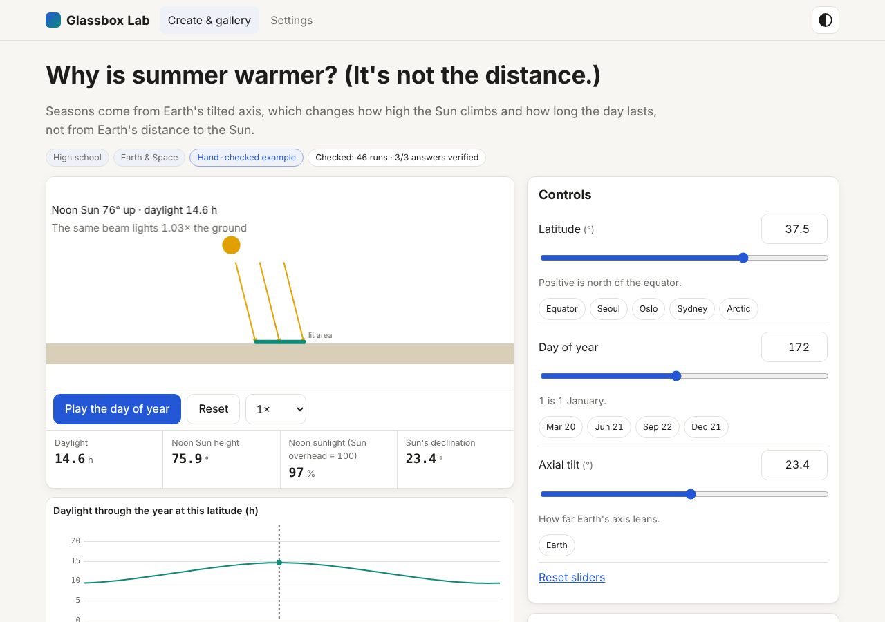

# Glassbox Lab

[](https://pollinations.ai/?ref=badge)

**Type a science topic, get a live simulation you can question.** Sliders, a guided tour, predict-then-test questions whose answers are checked by running the simulation, Wikipedia sources and a second-model review. You pay with your own Pollen (BYOP).

**Live app:** https://patbing.github.io/glassbox-lab/ · Pollinations quest #19181



## What it does

- **A simulation, not a widget.** The AI never writes code. It writes a small declarative model (sliders, equations, ODEs, shapes, charts). Glassbox's own engine parses it with a whitelisted expression language, runs it (RK4) and draws it. No `eval`, no `new Function`, no iframe code.
- **A guided tour** that moves the sliders for you and highlights what to look at. Each step can be narrated (Pollinations speech, or your device voice for free).
- **Predict, then test.** You lock in a guess ("the period will increase / decrease / stay the same"), then watch the app set the sliders and measure the result. The answer key is verified by the simulation itself; if the AI's key disagreed with its own model, the simulation's answer wins and the lesson says so.
- **Sources and a second opinion.** Sources are fetched from Wikipedia by the app before writing. The model may only cite those ids, so invented citations are detected and stripped. Claims carry a certainty label. A reviewer model (preferably another family) checks the lesson against its own equations and sources.
- **Offline export.** Any lesson downloads as one self-contained HTML file (CSP, no network, no key) that a teacher can put on a class drive.

## Try it without an account

- Open any of the four hand-checked **gallery lessons** (pendulum, predator–prey, chemical equilibrium and catalysts, the seasons). They run offline.
- Add **`?demo=1`** (or switch on Demo mode in Settings) to run the *whole* generation pipeline against pre-recorded model replies. The recorded first drafts contain planted mistakes, so you can watch the checker send precise errors back and the repair round fix them. Nothing is charged and nothing leaves the browser.

## How Pollinations is used

| Purpose | Endpoint |
|---|---|
| Writer and reviewer (text) | `POST https://gen.pollinations.ai/v1/chat/completions` |
| Cover illustration | `GET https://gen.pollinations.ai/image/{prompt}` |
| Tour narration | `POST https://gen.pollinations.ai/v1/audio/speech` |
| Live model discovery | `GET /text/models`, `/image/models`, `/audio/models` |
| Sign-in and billing | `<polli-connect>` (BYOP): users pay with their own Pollen |

Models are discovered at runtime, so renamed or newly added models keep working; Settings lets you pin any model. Every build shows a cost preview first, enforces a per-lesson Pollen cap (default 0.5) and shows spend live. Your key stays in this tab (the Connect component's `sessionStorage`) and is only sent to `gen.pollinations.ai` in an `Authorization` header, never in a URL.

## Why you can trust it, and when not to

Every simulation is run over about 60 slider settings before you see it: finite numbers, shapes on screen, every slider changes something you can see, something moves. Problems go back to the model (two repair rounds); if they persist, parts are removed, and as a last resort the app builds a simpler "relationship explorer" from the pieces that work. The **Equations** tab prints every equation the simulation runs, and **Sources & checks** lists exactly what was verified and what was not.

AI lessons can still be wrong. Passing the checks means the model is internally consistent and numerically sane, not that the science is right. Read the reviewer notes before teaching with a lesson.

## Lesson format

A lesson is one JSON object (`glassbox-lesson/1`): `sim` (params, constants, state, derived, shapes, charts), `tour`, `predictions`, `claims`, `glossary`, `misconceptions`, `media`. The full format text the model sees is `Glassbox.Prompts.FORMAT_SPEC` in `js/prompts.js`; the four gallery lessons in `lessons/gallery.js` are complete examples. To add a gallery lesson, append an object there and run the tests: `tests/gallery.test.js` requires 0 errors, 0 warnings and every prediction confirmed by the simulation.

Expressions use numbers, `+ - * / % ^`, comparisons, `&& || !`, `c ? a : b` and a fixed list of functions (`sin sqrt exp ln clamp lerp …`). Colors are theme tokens only.

## Run locally

```bash
python3 -m http.server 8123      # then open http://localhost:8123
node --test tests/*.test.js      # unit tests (no dependencies)
node tests/browser/smoke.mjs     # browser checks (needs Playwright; serve the folder first)
```

`index.html` also opens from `file://` (gallery, demo, export; sign-in needs http(s)).

## Set up your own copy

1. Create an App Key at https://enter.pollinations.ai/keys (Apps), with redirect URIs for your hosting URL and `http://localhost:8123`.
2. Put the public `pk_…` key in `CONFIG.APP_KEY` in `js/pollinations.js`.
3. Publish the folder (GitHub Pages works; `.nojekyll` is included). After editing `css/app.css`, run `node tools-build-css.js` (the offline export embeds a copy).

## Privacy and security

No backend, no analytics, no cookies. Model output is never executed and is only inserted with `textContent`. Source links are rendered only for Wikipedia URLs. Exports carry a Content-Security-Policy that blocks all network access and are checked for keys before they are written. Settings (but never the key) are stored in `localStorage`.

## License

MIT. Glassbox Lab is an independent project and is not affiliated with Wikipedia or any model provider.
